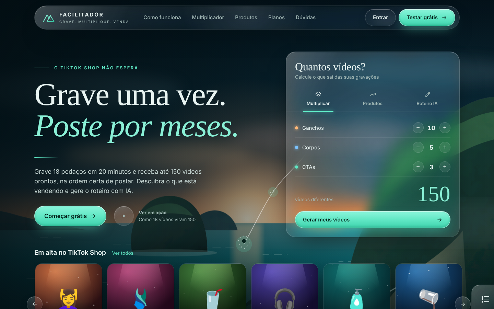
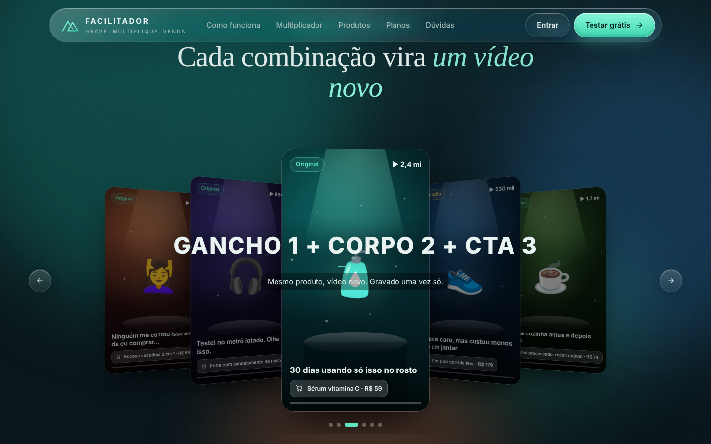
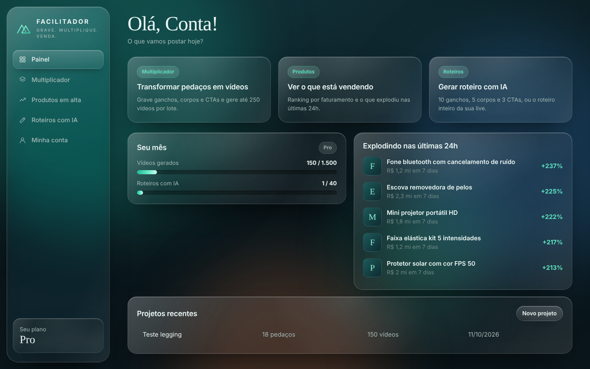

# Facilitador TikTok Shop

Plataforma para criadores e afiliados do TikTok Shop (nome provisório).

- **Multiplicador de vídeos**: o usuário grava ganchos, corpos e CTAs separados e a
  plataforma monta todas as combinações (10 × 5 × 3 = 150 vídeos), na ordem certa de
  postar, com selo de originalidade, data sugerida, legenda e um ZIP com tudo.
- **Produtos em alta**: ranking por faturamento, tendências 24h, comissão e vídeos que
  mais venderam (Brasil e EUA).
- **Roteiros com IA** (Claude): 10 ganchos + 5 corpos + 3 CTAs prontos para o
  Multiplicador, ou o roteiro de uma live com teleprompter e PDF.
- **Assinaturas** com Stripe, cota mensal por plano e garantia de 7 dias.

Visual "Liquid Glass": vidro translúcido com refração (no Chrome), brilho que segue o
cursor, títulos em serifa, paisagem com parallax, carrossel 3D e animações com a
biblioteca Motion.

## Onde os vídeos são processados

Num **worker**: um programa separado do site que roda o FFmpeg num servidor na nuvem
(Railway, Fly.io, Google Cloud Run ou uma VPS). O fluxo é:

```
navegador ──envia os pedaços direto──▶ Cloudflare R2 (armazenamento)
    │                                         ▲
    └─ pede o lote ─▶ API ─▶ fila (Postgres) ─▶ worker (FFmpeg) ─┘ devolve os vídeos prontos
```

1. Cada pedaço é **padronizado uma única vez** (1080x1920, 30 fps, volume igualado).
2. As combinações são **juntadas sem recodificar** (cópia), o que é muito barato.
   Medido aqui: 18 pedaços viram 150 vídeos em ~3 minutos, com ~5 minutos de CPU.
3. Os vídeos ficam 7 dias para download e depois são apagados sozinhos.

Para aguentar mais clientes ao mesmo tempo, basta subir mais cópias do worker.

## Custos e preço

Resumo (detalhes e premissas em [docs/CUSTOS.md](docs/CUSTOS.md), calculadora em
`npm run custos`):

| | Custo |
|---|---|
| 150 vídeos gerados (CPU + armazenamento) | ~R$ 0,13 |
| 1 roteiro com IA (Claude Opus 5.5) | ~R$ 0,55 |
| 1 roteiro com IA (Claude Haiku 5.5) | ~R$ 0,01 |
| Custos fixos para começar | ~R$ 200/mês + provedor de dados |

Planos sugeridos: **Grátis** (20 vídeos), **Criador R$ 49/mês** (300 vídeos),
**Pro R$ 89/mês ou R$ 597/ano** (1.500 vídeos). Margem de 49% a 95% por cliente,
dependendo do uso e do modelo de IA. Os valores ficam em `src/shared/plans.ts`.

## Rodando no computador

Requer Node.js 22+, Postgres 16 e FFmpeg (ou só Docker).

**Com Docker** (mais fácil):

```bash
cp .env.example .env
docker compose up --build
docker compose exec api npx tsx src/server/seed.ts   # produtos de exemplo + conta de teste
# abra http://localhost:3000  (demo@facilitador.local / demo12345)
```

**Sem Docker**:

```bash
npm install
cp .env.example .env         # ajuste DATABASE_URL
npm run migrate && npm run seed
npm run dev                  # site em http://localhost:5173, API na 3000 e worker juntos
```

Sem chaves configuradas tudo funciona em modo de demonstração: vídeos salvos na pasta
`data/`, roteiros de exemplo no lugar da IA e assinatura ativada sem pagamento.

Testes: `npm test` · Tipos: `npm run typecheck` · Build: `npm run build`

## Estrutura

```
src/
  shared/      planos e algoritmo de combinações/ordem de postagem (com testes)
  server/      API (Fastify): login, Multiplicador, roteiros, produtos, pagamentos, armazenamento
  worker/      fila de lotes + FFmpeg (padroniza, junta, gera ZIP, limpa vencidos)
  web/         site (React + Motion): página inicial, planos, painel
    components/fx.tsx        vidro líquido, brilho do cursor, animações
    components/Scene.tsx     paisagem e artes em SVG
    components/Coverflow.tsx carrossel 3D de vídeos
db/migrations/ esquema do banco
scripts/custos.ts calculadora de custo e margem
docs/          custos, publicação e dados de produtos
```

## Próximos passos

1. Criar as contas e publicar: [docs/DEPLOY.md](docs/DEPLOY.md).
2. Escolher o provedor de dados de produtos: [docs/DADOS.md](docs/DADOS.md).
3. Definir o nome e a marca. "TikTok" no nome pode gerar problema de marca registrada;
   vale trocar antes de investir em divulgação.
4. Termos de uso e política de privacidade (LGPD), e-mails de boas-vindas e recuperação de senha.

## Telas

| Início | Carrossel 3D | Painel |
|---|---|---|
|  |  |  |
